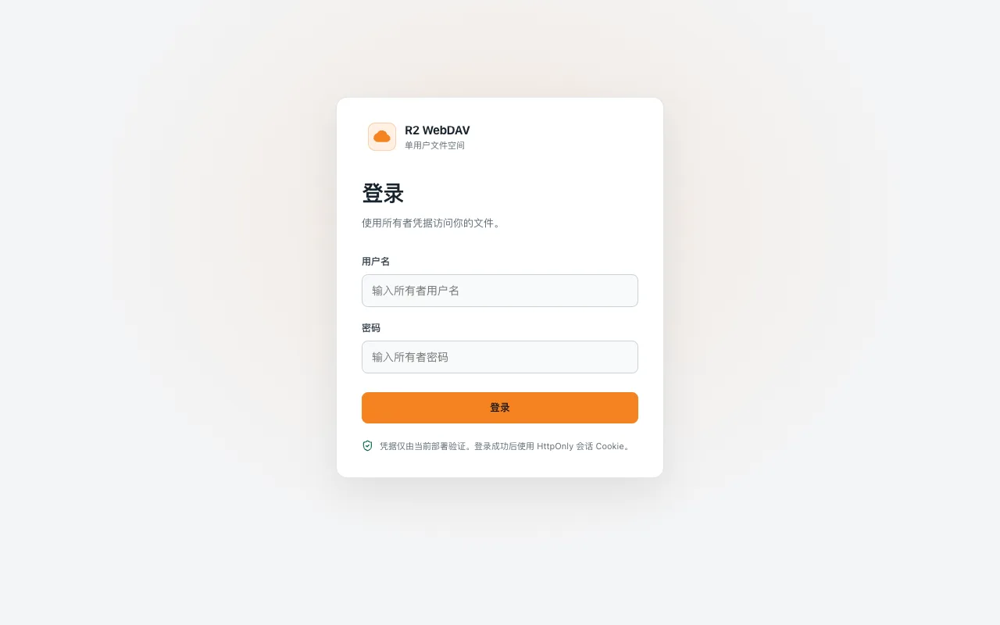
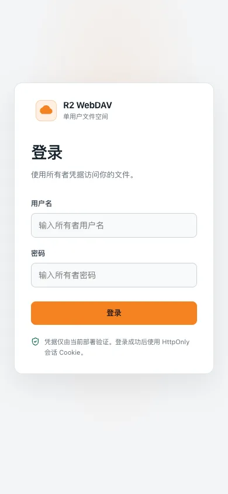
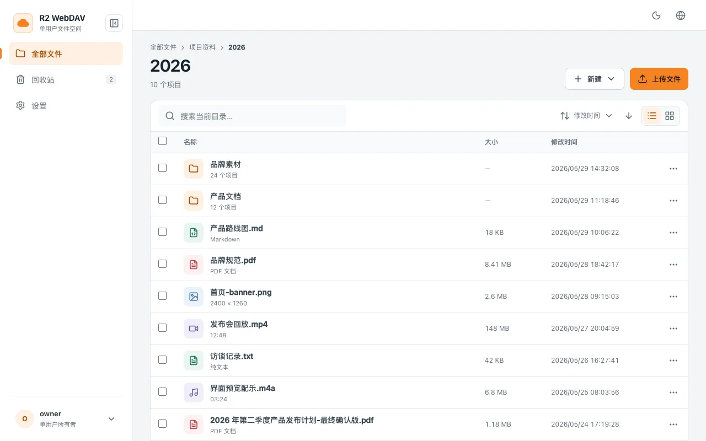
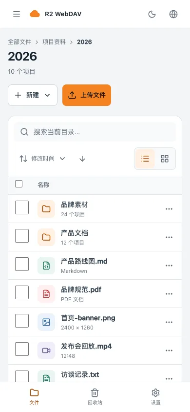
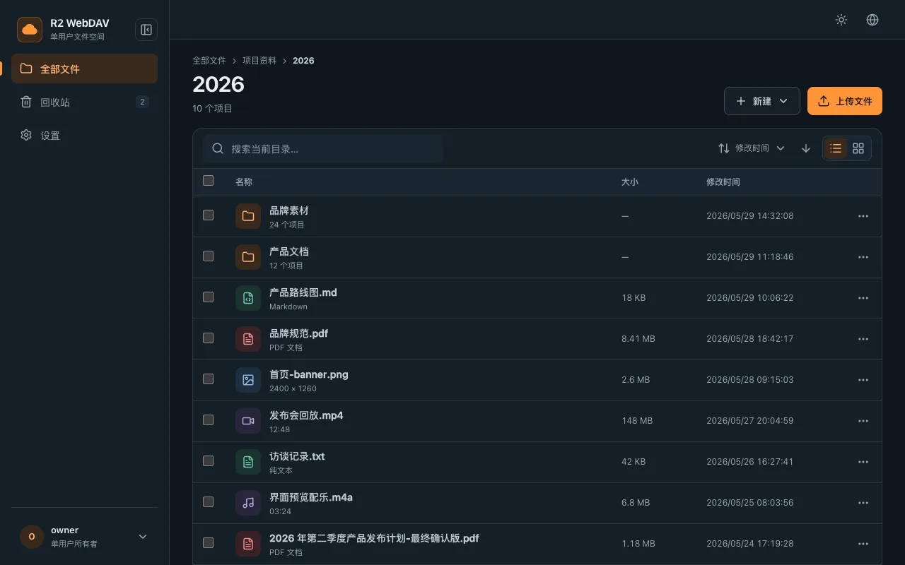
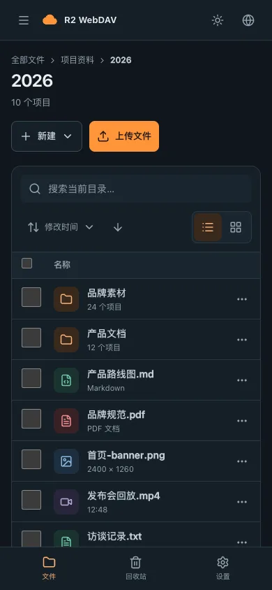
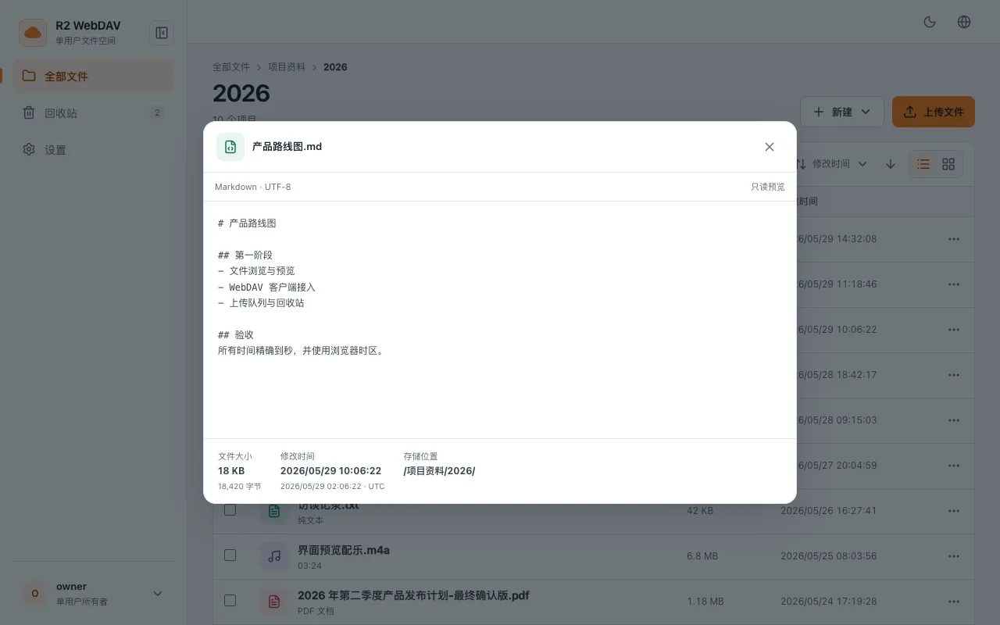
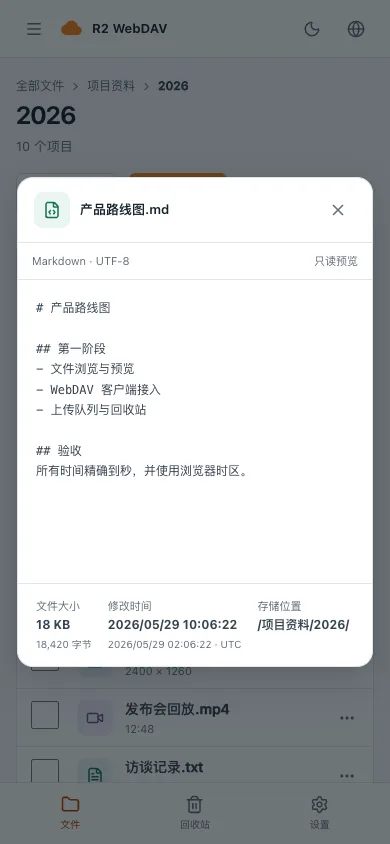
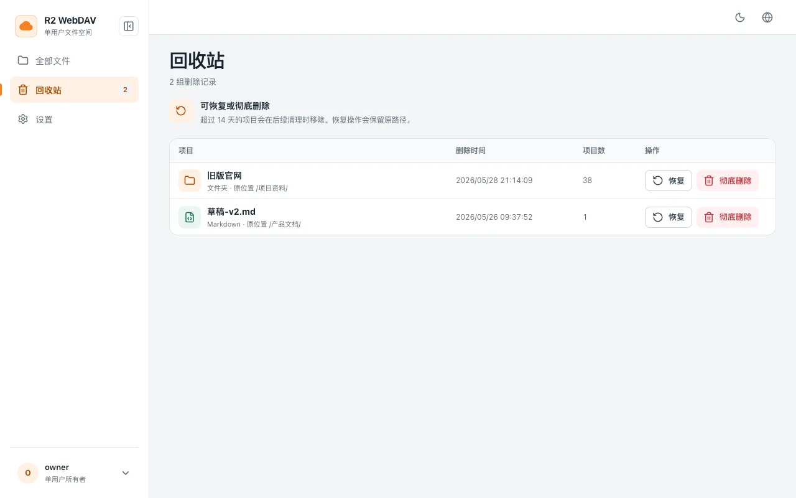
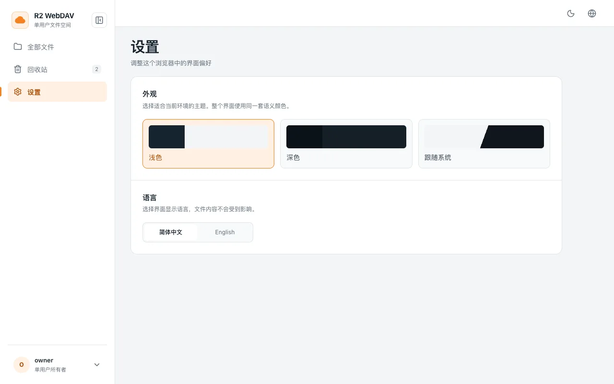

<p align="center">
  
</p>

<h1 align="center">R2 WebDAV</h1>

<p align="center">
  A modern single-owner file space built on Cloudflare R2.<br />
  WebDAV first, with file management, online previews, and secure authentication.
</p>

<p align="center">
  <code>Cloudflare Pages</code> · <code>R2</code> · <code>React 19</code> ·
  <code>Vite 8</code> · <code>Tailwind 4</code> · <code>MIT</code>
</p>

<p align="center">
  <a href="#features">Features</a> ·
  <a href="#prototype-gallery">Prototype</a> ·
  <a href="#deploy">Deploy</a> ·
  <a href="#development">Development</a> ·
  <a href="#acknowledgments">Acknowledgments</a>
</p>

For Chinese documentation, see [README.zh.md](./README.zh.md).

---

## Prototype gallery

[View the static prototype](./docs/prototype.html) · All screenshots use demo data, with no production files or account information.

| Desktop · Login | Mobile · Login |
| --- | --- |
|  |  |

<details>
<summary><strong>View the other 11 screenshots: light/dark files, preview, trash, and settings</strong></summary>

<br />

| Page | Desktop (1280×800) | Mobile (390×844) |
| --- | --- | --- |
| Files · Light |  |  |
| Files · Dark |  |  |
| Preview |  |  |
| Trash |  |  |
| Settings |  |  |

</details>

## Features

- **Modern UI** — React 19 + Vite 8 + Tailwind v4 + shadcn/ui (Radix), with responsive desktop, tablet, and mobile layouts.
- **Authentication** — `/login` with a JWT session cookie (HMAC-SHA256 derived from `WEBDAV_PASSWORD`); changing the password revokes every existing session.
- **File operations** — Browse / create folders / upload / rename / delete / copy / move / multi-select, with breadcrumbs and client-side search.
- **Multi-type preview** — Images, video, audio, PDF, code (Shiki with on-demand language registration), and plain text (1 MB cap).
- **TextPad** — Quick `.txt` / `.md` upload drawer for saving notes directly into the current directory.
- **Trash** — Soft-delete to an internal namespace with 14-day retention. View, restore, or permanently delete via `/trash`; expired entries are purged opportunistically on later DELETE requests (~10% sampling), with no scheduled cleanup.
- **i18n** — Zh-CN / English auto-detection with a persisted user override.
- **Dark mode** — Light / dark / follow-system, persisted to localStorage.
- **Settings page** — `/settings` for theme and language controls.
- **Thumbnails & large files** — Auto-generated image / video / PDF thumbnails; multipart upload for files ≥ 100 MB through the web UI, while standard WebDAV clients are limited to 100 MB by Cloudflare Workers.
- **WebDAV endpoint** — Compatible with rclone, [Cx File Explorer](https://play.google.com/store/apps/details?id=com.cxinventor.file.explorer), [BD File Manager](https://play.google.com/store/apps/details?id=com.liuzho.file.explorer), and standards-compliant WebDAV clients.
- **Security** — Content Security Policy (enforce mode), nosniff, Referrer-Policy, and Permissions-Policy.

## Deploy

### Prerequisites

- A [Cloudflare](https://dash.cloudflare.com/) account
- R2 enabled with at least one bucket created
- (Optional) A custom domain

### Option A — Cloudflare Pages UI integration (recommended)

1. Fork this repository and connect your fork to Cloudflare Pages:
   - Framework preset: **None** (uses Vite directly)
   - Build command: `npm run build`
   - Build output directory: `dist`
2. After the initial build, go to your Pages project → **Settings**:
   - **Bindings** → Add an **R2 bucket binding** with **Variable name** = `BUCKET`, pointing to your bucket
   - **Variables and Secrets** → Add `WEBDAV_USERNAME` and `WEBDAV_PASSWORD` (both encrypted), plus optional `WEBDAV_PUBLIC_READ = 0 or 1` (plain text, defaults to `0`)
3. Trigger a redeploy from **Deployments** so the bindings take effect.
4. (Optional) Add a custom domain in **Custom domains**.

### Option B — Wrangler CLI

```bash
cp wrangler.toml.example wrangler.toml
# Edit wrangler.toml: change name and bucket_name to your values
npm run build
npx wrangler pages deploy dist
```

Secrets must be set once via the Cloudflare Dashboard or `wrangler pages secret put`:

```bash
npx wrangler pages secret put WEBDAV_USERNAME --project-name=<your-project>
npx wrangler pages secret put WEBDAV_PASSWORD --project-name=<your-project>
```

<details>
<summary><strong>Advanced deployment, authentication & limits</strong></summary>

### Authentication

R2 WebDAV uses a modern `/login` page rather than HTTP Basic Auth. On successful login, the server sets a JWT cookie (`r2_session`) signed with HMAC-SHA256 and derived from `WEBDAV_PASSWORD`. Changing the password and redeploying invalidates all existing sessions.

For WebDAV clients that do not support the login page, the WebDAV endpoint accepts HTTP Basic Auth headers directly.

### WebDAV endpoint

- **URL:** `https://<your-domain>/webdav`
- **Username:** `WEBDAV_USERNAME`
- **Password:** `WEBDAV_PASSWORD`

**Large file upload limit:** Cloudflare Free / Pro plans cap incoming request bodies at **100 MB** (Business 200 MB, Enterprise up to 5 GB with self-serve adjustment). Files larger than that must be uploaded through the web UI, which automatically uses chunked multipart upload.

**COPY / MOVE / DELETE limit (plan-independent):** A single object is capped at **5 GiB** (the R2 single-PUT hard limit; the Workers binding does not expose server-side multipart copy). DELETE also requires copying the object to the trash namespace, so the same 5 GiB cap applies. Larger objects must be deleted via rclone against the R2 S3 endpoint.

Recursive COPY/MOVE is also bound by the Workers subrequest budget per request — R2 calls count as subrequests to Cloudflare services (~1,000 on Free, 10,000 on Paid; each child costs ~2–3 calls for COPY/DELETE, ~5 for MOVE = copy + trash-delete). For larger objects or directories, prefer rclone against the R2 S3 endpoint directly.

### Rate limiting (recommended)

To protect `/api/login` from brute-force attempts, add a Cloudflare **Rate Limiting Rule**:

1. Cloudflare Dashboard → your zone → **Security** → **WAF** → **Rate limiting rules**
2. Create a rule:
   - **If:** `(http.request.uri.path eq "/api/login" and http.request.method eq "POST")`
   - **Then:** Block, with a threshold of e.g. 5 requests per 1 minute per IP

This is optional but strongly recommended for production deployments.

### R2 lifecycle: abort incomplete multipart uploads (recommended)

Large file uploads use S3-style multipart. If a client aborts mid-upload due to a crash or network drop, the already-uploaded parts stay in the bucket and are billed as storage. R2's bucket lifecycle can clean them up automatically.

Configure the rule once via `wrangler`:

```bash
npx wrangler r2 bucket lifecycle add <your-bucket> \
  --name "abort-incomplete-mpu" \
  --abort-multipart-days 7
```

Or in the Cloudflare Dashboard → R2 → your bucket → **Settings** → **Object lifecycle rules**, add a rule with **Abort incomplete multipart uploads after** = `7 days`.

R2 then aborts any multipart upload not completed within the window. No application code or cron job is needed.

</details>

## Customization

- **Theme** — Settings page → toggle Light / Dark / System
- **Language** — Settings page → toggle 中文 / English

Preferences are stored in `localStorage` (`r2_theme`, `i18nextLng`).

## Development

See [docs/development.md](./docs/development.md) for the contributor guide, including the UI development workflow, server-side preview-branch workflow, optional local full-stack setup (`wrangler pages dev`), and how to change the WebDAV password.

<a id="acknowledgments"></a>

<details>
<summary><strong>Acknowledgments</strong></summary>

This project would not exist without the original work of the FlareDrive community.

### Original FlareDrive

R2 WebDAV is a fork of [FlareDrive](https://github.com/longern/FlareDrive) by [Siyu Long](https://github.com/longern) ([@longern](https://github.com/longern)), with additional contributions from [@SujalPatel-2020](https://github.com/SujalPatel-2020) and other [contributors](https://github.com/longern/FlareDrive/graphs/contributors).

The R2 WebDAV fork (2026-) was rewritten across Phase 0-3:

- **Phase 0** — Build chain modernization (CRA → Vite 8, Material-UI → Tailwind v4 + shadcn/ui)
- **Phase 1** — Authentication overhaul (JWT cookie + session secret derivation + revocation hooks)
- **Phase 2** — Full UI rebuild (file CRUD, preview dialog, TextPad drawer, i18n, dark mode, settings page)
- **Phase 3** — Hardening (Content Security Policy enforce, Lighthouse, documentation)

### Upstream WebDAV

The WebDAV protocol implementation is based on [r2-webdav](https://github.com/abersheeran/r2-webdav) by [abersheeran](https://github.com/abersheeran), preserved from the original FlareDrive project.

### License

R2 WebDAV is distributed under the [MIT License](./LICENSE), inheriting the license of the original FlareDrive project. See `LICENSE` for full copyright attribution.

</details>
