<p align="center">
  
</p>

<h1 align="center">R2 WebDAV</h1>

<p align="center">
  基于 Cloudflare R2 的现代化单用户文件空间。<br />
  WebDAV 优先，兼顾文件管理、在线预览与安全鉴权。
</p>

<p align="center">
  <code>Cloudflare Pages</code> · <code>R2</code> · <code>React 19</code> ·
  <code>Vite 8</code> · <code>Tailwind 4</code> · <code>MIT</code>
</p>

<p align="center">
  <a href="#功能特性">功能特性</a> ·
  <a href="#原型预览">原型预览</a> ·
  <a href="#部署">部署</a> ·
  <a href="#开发">开发</a> ·
  <a href="#致谢">致谢</a>
</p>

For English documentation, see [README.md](./README.md).

---

## 原型预览

[查看静态原型源文件](./docs/prototype.html) · 所有截图均来自演示数据，不包含生产文件或账户信息。

| 桌面端 · 登录 | 移动端 · 登录 |
| --- | --- |
| 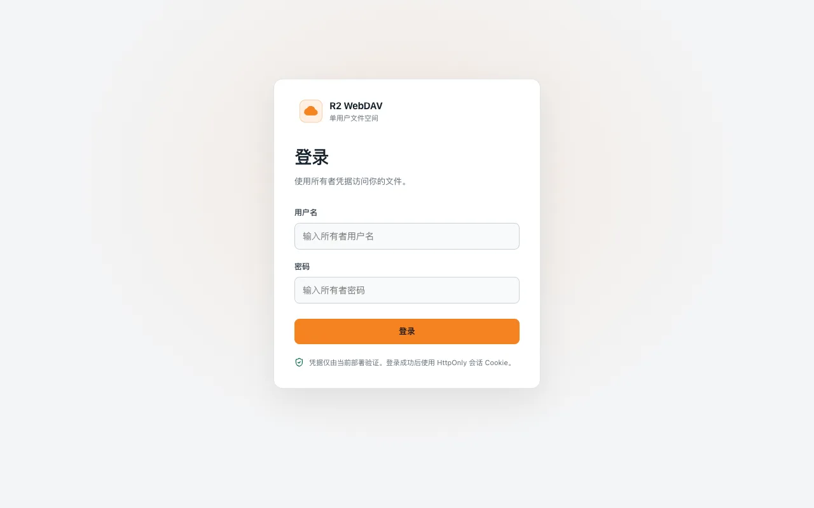 | 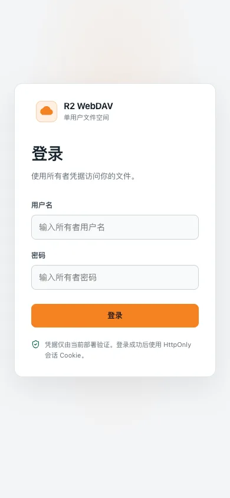 |

<details>
<summary><strong>展开其余 11 张效果图：文件页浅色/深色、预览、回收站与设置</strong></summary>

<br />

| 页面 | 桌面端（1280×800） | 移动端（390×844） |
| --- | --- | --- |
| 文件页 · 浅色 | 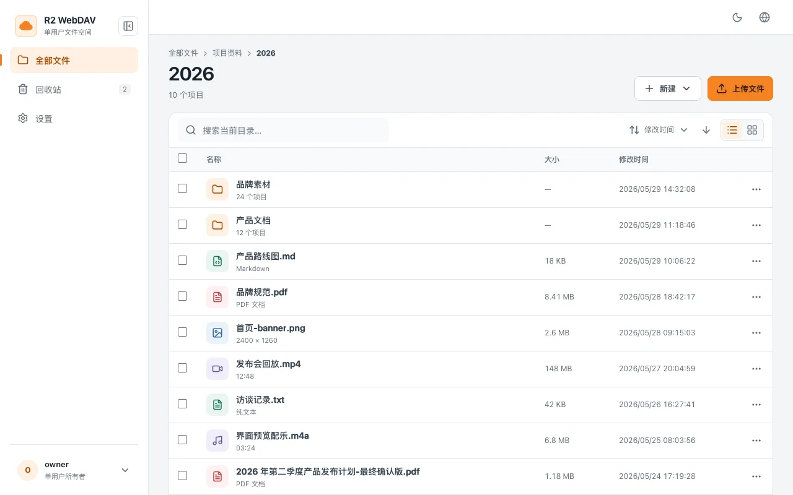 | 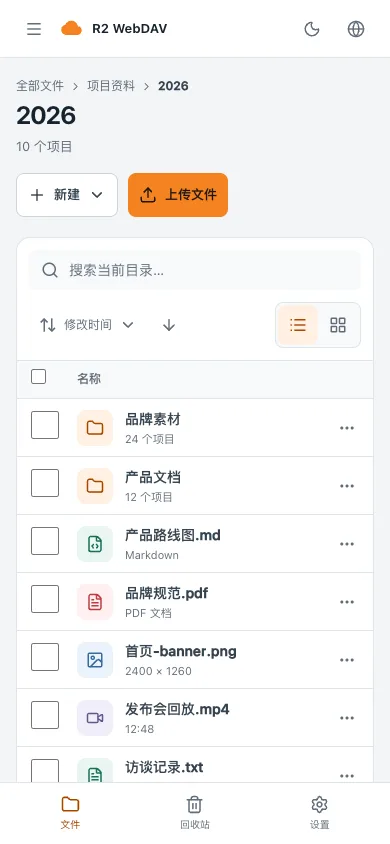 |
| 文件页 · 深色 | 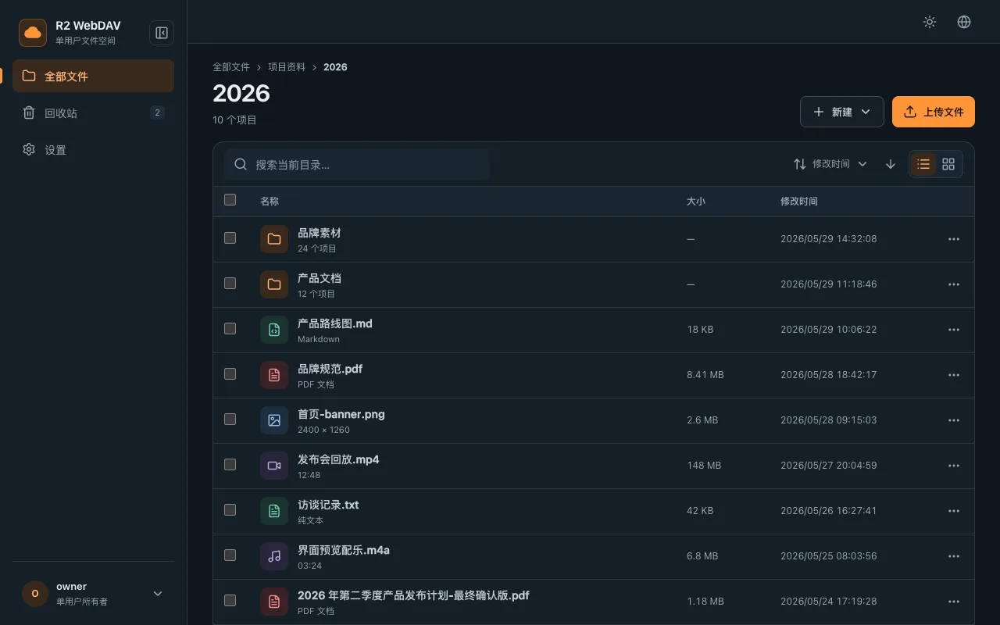 | 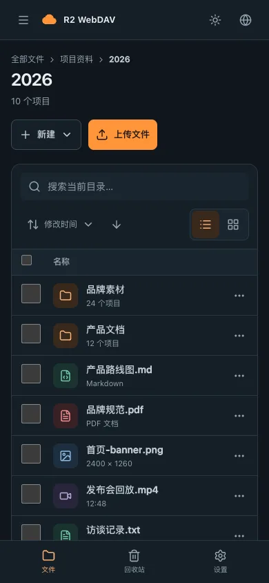 |
| 文件预览 | 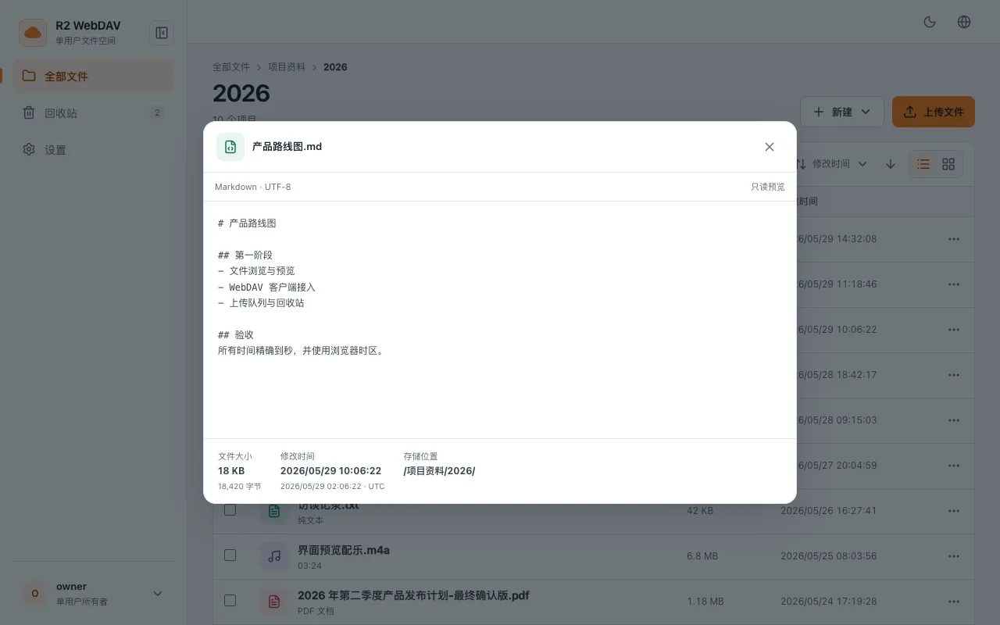 | 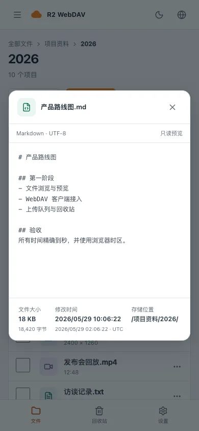 |
| 回收站 | 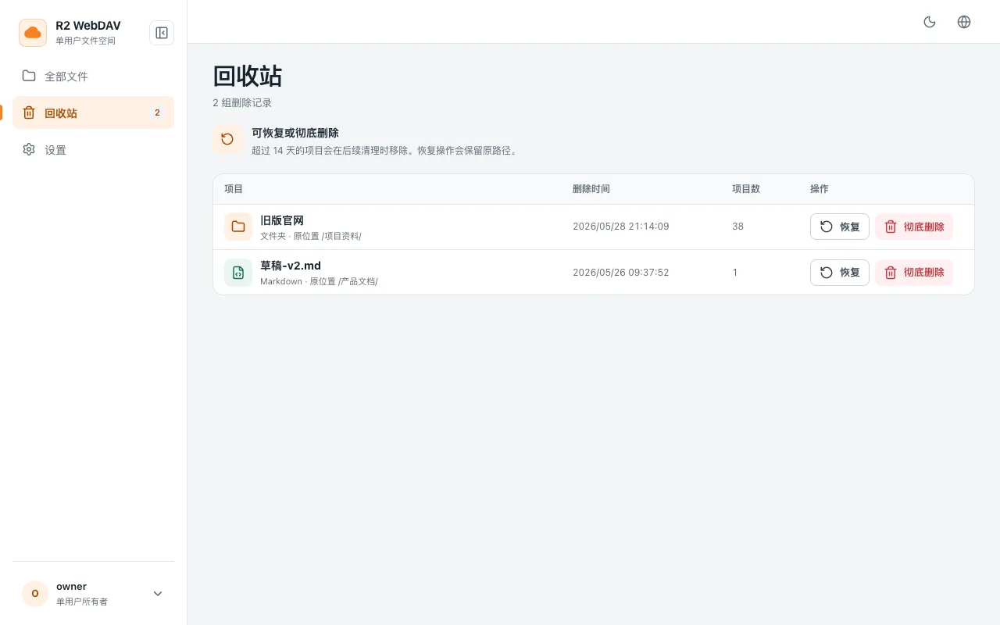 |  |
| 设置 | 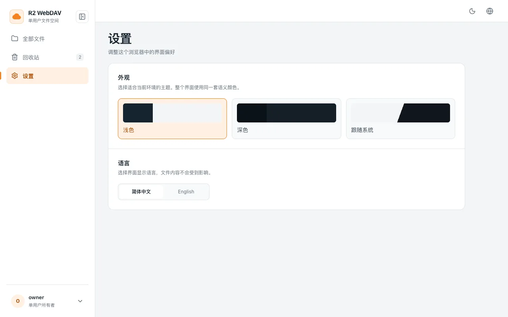 | 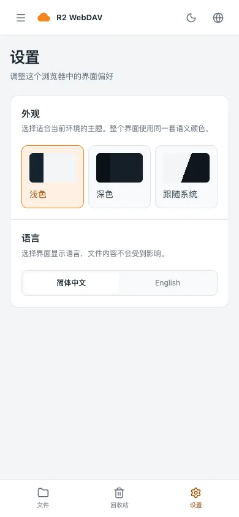 |

</details>

## 功能特性

- **现代化 UI** — React 19 + Vite 8 + Tailwind v4 + shadcn/ui (Radix)，桌面、平板和移动端响应式布局。
- **登录鉴权** — `/login` 页面 + JWT session cookie（HMAC-SHA256 派生自 `WEBDAV_PASSWORD`）；修改密码后所有现有会话自动失效。
- **文件操作** — 浏览 / 新建文件夹 / 上传 / 重命名 / 删除 / 复制 / 移动 / 多选，含面包屑导航与客户端搜索。
- **多类型预览** — 图片、视频、音频、PDF、代码（Shiki 按需注册语言）和纯文本（1 MB 上限）。
- **TextPad** — 快捷 `.txt` / `.md` 上传抽屉，直接保存到当前目录。
- **回收站** — 删除的文件先软删除到内部命名空间（保留 14 天），可在 `/trash` 查看、恢复或彻底删除；过期条目仅在后续 DELETE 请求中按约 10% 概率清理，无定时任务。
- **中英双语** — Zh-CN / English 自动检测，支持用户切换并持久化。
- **暗色模式** — 浅色 / 深色 / 跟随系统，偏好保存在 localStorage。
- **设置页面** — `/settings` 主题 + 语言切换。
- **缩略图与大文件** — 图片 / 视频 / PDF 自动生成缩略图；Web UI 支持分片上传（≥ 100 MB），标准 WebDAV 客户端受 Cloudflare Workers 限制最大 100 MB。
- **WebDAV 端点** — 兼容 rclone、[Cx File Explorer](https://play.google.com/store/apps/details?id=com.cxinventor.file.explorer)、[BD File Manager](https://play.google.com/store/apps/details?id=com.liuzho.file.explorer) 以及符合标准的 WebDAV 客户端。
- **安全策略** — Content Security Policy（enforce 模式）、nosniff、Referrer-Policy、Permissions-Policy。

## 部署

### 前置条件

- [Cloudflare](https://dash.cloudflare.com/) 账号
- 已启用 R2 服务并创建至少一个 bucket
- （可选）自定义域名

### 方案 A — Cloudflare Pages 网页集成（推荐）

1. Fork 本仓库并在 Cloudflare Pages 中连接你的 fork：
   - Framework preset 选 **None**（直接使用 Vite）
   - Build command：`npm run build`
   - Build output directory：`dist`
2. 首次构建完成后，进入 Pages 项目 → **Settings**：
   - **Bindings** → 新增 **R2 bucket binding**，**Variable name** = `BUCKET`，指向你的 R2 bucket
   - **Variables and Secrets** → 新增 `WEBDAV_USERNAME`、`WEBDAV_PASSWORD`（均加密），以及可选的 `WEBDAV_PUBLIC_READ = 0 或 1`（明文，默认 `0`）
3. 进入 **Deployments** 触发重新部署，让 bindings 生效。
4. （可选）在 **Custom domains** 添加自定义域名。

### 方案 B — Wrangler 命令行

```bash
cp wrangler.toml.example wrangler.toml
# 编辑 wrangler.toml：把 name 和 bucket_name 改成你的值
npm run build
npx wrangler pages deploy dist
```

Secrets 必须通过 Cloudflare 仪表盘或 `wrangler pages secret put` 设置一次：

```bash
npx wrangler pages secret put WEBDAV_USERNAME --project-name=<your-project>
npx wrangler pages secret put WEBDAV_PASSWORD --project-name=<your-project>
```

<details>
<summary><strong>高级部署、鉴权与限制</strong></summary>

### 登录鉴权

R2 WebDAV 使用现代化的 `/login` 页面，不再使用 HTTP Basic Auth 弹窗。登录成功后服务端设置 JWT cookie（`r2_session`），使用 HMAC-SHA256 签名，密钥派生自 `WEBDAV_PASSWORD`。修改密码并重新部署后，所有现有会话立即失效。

对于不支持登录页面的 WebDAV 客户端，WebDAV 端点直接接受 HTTP Basic Auth 头。

### WebDAV 端点

- **URL：** `https://<your-domain>/webdav`
- **用户名：** `WEBDAV_USERNAME`
- **密码：** `WEBDAV_PASSWORD`

**大文件直传限制：** Cloudflare 免费 / Pro 套餐入站请求体上限 **100 MB**（Business 200 MB，Enterprise 最高 5 GB 可自助调整）。超过此大小的文件必须通过 Web UI 上传（自动走分片上传）。

**COPY / MOVE / DELETE 限制（与套餐无关）：** 单对象上限 **5 GiB**（R2 单次 PUT 硬限，binding 不支持服务端 multipart copy）。DELETE 同样需要先把对象复制到回收站，因此 5 GiB 上限同样适用；超过上限的对象无法通过 WebDAV 删除，请改用 rclone 直接对 R2 S3 端点操作。

批量 COPY/MOVE 的递归操作还受 Workers subrequest 上限约束 —— R2 调用计入对 Cloudflare 服务的 subrequest（免费套餐每请求约 1000 次，付费 10000 次；每个子节点约消耗 2–3 次调用，MOVE 约 5 次 = 复制 + 软删除）。目录规模较大时同样建议使用 rclone。

### 频率限制（推荐配置）

为防止 `/api/login` 被暴力破解，建议在 Cloudflare 配置 **Rate Limiting Rule**：

1. Cloudflare Dashboard → 你的 zone → **Security** → **WAF** → **Rate limiting rules**
2. 新增规则：
   - **If：** `(http.request.uri.path eq "/api/login" and http.request.method eq "POST")`
   - **Then：** Block，阈值如 5 次/分钟/IP

可选配置，但生产环境强烈推荐。

### R2 生命周期：自动清理未完成的分片上传（推荐配置）

大文件上传走 S3 风格的分片协议。如果客户端在上传途中崩溃或网络断开，已上传的分片会留在 R2 桶里继续计费。R2 桶级生命周期规则可以自动清理。

用 `wrangler` 一次性配置：

```bash
npx wrangler r2 bucket lifecycle add <your-bucket> \
  --name "abort-incomplete-mpu" \
  --abort-multipart-days 7
```

或在 Cloudflare Dashboard → R2 → 你的桶 → **设置** → **对象生命周期规则** → 新建规则，把 **未完成的分片上传中止时间** 设为 `7 天`。

R2 会按规则自动 abort 超时未完成的 multipart upload，无需写代码也无需配 cron。

</details>

## 个性化设置

- **主题** — 设置页 → 切换浅色 / 深色 / 跟随系统
- **语言** — 设置页 → 切换中文 / English

偏好保存在 `localStorage`（`r2_theme`、`i18nextLng`）。

## 开发

参见 [docs/development.md](./docs/development.md)（英文），含 UI 开发工作流、服务端 preview branch 工作流、可选的本地全栈调试（`wrangler pages dev`）以及如何修改 WebDAV 密码。

<a id="致谢"></a>

<details>
<summary><strong>致谢</strong></summary>

本项目基于 FlareDrive 社区的原创工作。

### 原 FlareDrive 项目

R2 WebDAV 是 [Siyu Long](https://github.com/longern)（[@longern](https://github.com/longern)）创建的 [FlareDrive](https://github.com/longern/FlareDrive) 的 fork，[@SujalPatel-2020](https://github.com/SujalPatel-2020) 及其他[贡献者](https://github.com/longern/FlareDrive/graphs/contributors)也参与了原项目。

R2 WebDAV fork（2026-）在 Phase 0-3 中完成重写：

- **Phase 0** — 构建链现代化（CRA → Vite 8、Material-UI → Tailwind v4 + shadcn/ui）
- **Phase 1** — 鉴权重构（JWT cookie + session secret 派生 + 失效钩子）
- **Phase 2** — UI 全量重建（文件 CRUD、预览对话框、TextPad 抽屉、i18n、暗色模式、设置页）
- **Phase 3** — 加固（Content Security Policy enforce、Lighthouse、文档）

### 上游 WebDAV

WebDAV 协议实现基于 [abersheeran](https://github.com/abersheeran) 的 [r2-webdav](https://github.com/abersheeran/r2-webdav)，保留自原 FlareDrive 项目。

### 许可证

R2 WebDAV 采用与原 FlareDrive 项目相同的 [MIT License](./LICENSE)。完整版权署名见 `LICENSE` 文件。

</details>
